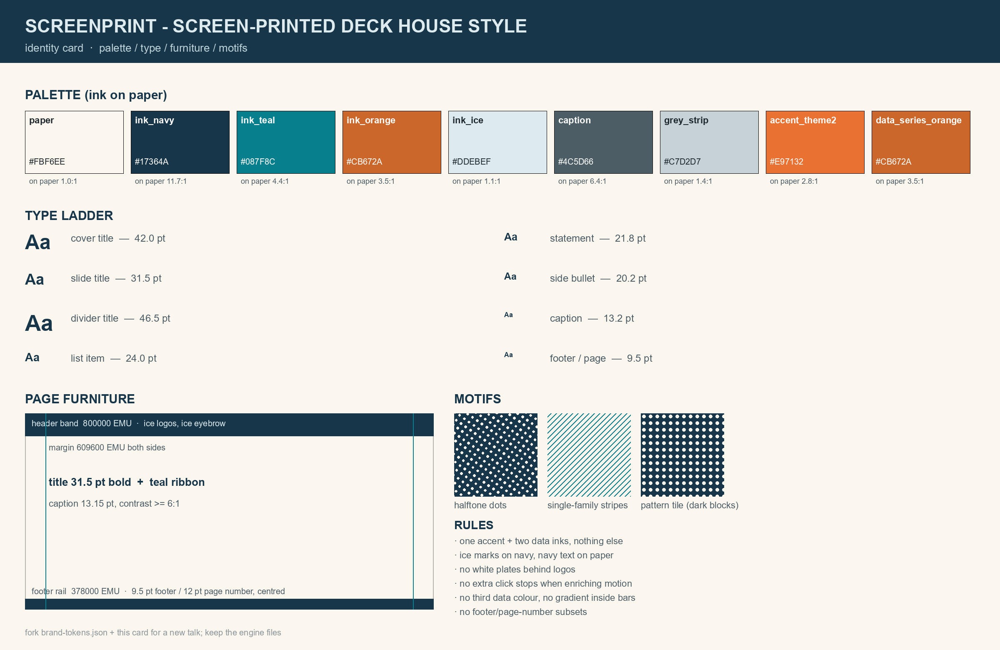

# screenprint

**Screen-printed deck skills for AI coding agents** — a working method (and toolchain) for
producing real conference/defence decks with PowerPoint fidelity: OOXML-level edits,
native charts, embedded video, custom print-style figure assets, animation, audits and the
matching speech pack.



Two skills ship here:

| Skill | What it does |
|---|---|
| [`screenprint`](skills/screenprint) | the engine: workflow, OOXML recipes, scripts, house identity |
| [`screenprint-defense`](skills/screenprint-defense) | 答辩 variant: contribution-first structure, question bank, backup pages |

The name is the style: the house identity is ink printed on warm paper — halftone dot screens,
single-family stripes, ice marks on navy, registration rings.

## Why another PPT skill

Most "make me slides" pipelines stop at `python-pptx` writing a file. This one treats a deck as
**a product with evidence**: every page is rendered by PowerPoint and looked at, every animation
is validated by re-opening the file, every parity claim ("text unchanged", "43 click groups",
"videos byte-identical") comes from a script, and every iteration is an immutable version folder.
It also encodes the pitfalls that silently corrupt decks (invalid pattern presets, wrong chart
build nesting, data-label schema order, one-PDF-per-COM-session, media rel traps).

## What is inside

```
skills/screenprint/
  SKILL.md                     control layer: non-negotiables, workflow, routing, command bank, pitfalls
  references/00-deck-fundamentals.md   deck budget, projection legibility, density, evidence discipline
  references/01-workflow-and-versioning.md
  references/02-ooxml-recipes.md       animation, chart build, media loop, fills, rels
  references/03-figure-assets.md       halftone / stripes / ramps, baking textures into paper
  references/04-video-pipeline.md      Blender render -> ffmpeg -> swap -> poster -> loop
  references/05-layout-and-typography.md
  references/06-audit-and-delivery.md  COM export, structural audit, on-site kit
  references/07-speech-and-cues.md     speech script, pointer phrases, cue card
  references/08-house-identity.md      palette / type / furniture / motifs, how to fork
  references/09-local-tools.md         local tool manifest, authorisation, recipes
  assets/identity/brand-tokens.json    machine-readable house style
  assets/identity/IDENTITY_CARD.png
  notes/                               decision logs
  scripts/                             probe, verify, diff, layout audit, ooxml ops, export, texture, contact sheet
skills/screenprint-defense/
  SKILL.md, references/defense-playbook.md
examples/decision-log.md               a real 30-slide deck, annotated
```

## Install

Skills are plain folders with a `SKILL.md`. Copy them where your agent looks for skills:

```powershell
# Codex CLI / Codex app
Copy-Item -Recurse skills\screenprint,%USERPROFILE%\.codex\skills\
Copy-Item -Recurse skills\screenprint-defense,%USERPROFILE%\.codex\skills\

# DeepSeek Harness (DSH)
Copy-Item -Recurse skills\screenprint,%USERPROFILE%\.dsh\skills\
Copy-Item -Recurse skills\screenprint-defense,%USERPROFILE%\.dsh\skills\
```

Or run the bundled sync script (copies to both homes):

```powershell
powershell -ExecutionPolicy Bypass -File skills\screenprint\scripts\sync_skill.ps1
powershell -ExecutionPolicy Bypass -File skills\screenprint\scripts\sync_skill.ps1 `
  -Name screenprint-defense -Source .\skills\screenprint-defense
```

## Requirements

| Need | Why | Required? |
|---|---|---|
| Windows + Microsoft PowerPoint | the only trustworthy renderer (PNG/PDF export, media properties) | yes, for the audit loop |
| Python 3.10+ with `python-pptx`, `lxml`, `Pillow`, `numpy`, `pypdf` | all OOXML editing and image work | yes |
| `ffmpeg` / `ffprobe` | clip encoding and probing | for video |
| Blender | optional, for concept clips rendered from a `.blend` scene | for video |
| ComfyUI (local) | optional, texture/concept masters via `scripts/gen_texture.py` | optional |

Nothing is hard-coded to one machine: run

```powershell
python scripts\detect_tools.py
```

to see what is available and which environment variables the optional tools should point at.

## Quick start

```powershell
python skills\screenprint\scripts\pptx_probe.py deck.pptx --json probe.json
powershell -ExecutionPolicy Bypass -File skills\screenprint\scripts\export.ps1 `
  -Pptx deck.pptx -OutDir out\png -Png
python skills\screenprint\scripts\verify_package.py deck.pptx --ref previous.pptx `
  --expect-slides 30 --expect-clicks 43 --json audit.json
python skills\screenprint\scripts\layout_audit.py deck.pptx
python skills\screenprint\scripts\ooxml_ops.py chart-build copy.pptx `
  --slide 10 --shape-id 5 --mode category --wipe right
python skills\screenprint\scripts\make_identity_card.py `
  --tokens skills\screenprint\assets\identity\brand-tokens.json --out card.png
```

## Forking for a new deck genre

`screenprint` is the engine. Genre skills are siblings with the same prefix
(`screenprint-defense`, later `screenprint-poster`, `screenprint-lecture`…). A variant never
copies the engine: it loads `screenprint` and adds only what its genre changes. To restyle the
house identity, edit `brand-tokens.json` and regenerate the identity card — every script reads
tokens, none hard-codes colours.

## License

MIT — see [LICENSE](LICENSE).
